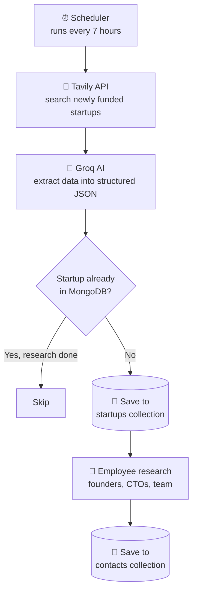

---------------------------------------------------
# 🚀 StartlyAI – AI-Powered Startup Research Platform

StartlyAI automatically finds **newly funded startups** and collects their **company details, founders, employees and public professional contacts** — so you don't have to research everything by hand.


---

## 📌 The Problem

Finding newly funded startups is slow and repetitive:

- Visiting many websites to find funding news
- Collecting company information manually
- Searching for employees, LinkedIn profiles and contact details one by one
- Repeating searches, which wastes API cost

## ✅ The Solution

StartlyAI automates the whole process. It:

- Finds newly funded startups
- Converts messy web data into **structured JSON**
- **Skips duplicate research** to save time and API calls
- Collects employee and public contact information
- Stores everything in MongoDB, ready to use

---

## ⚙️ How It Works



| Step | What happens |
|------|--------------|
| **1. Scheduler** | Automatically triggers research every 7 hours |
| **2. Tavily API** | Searches the web for newly funded startups |
| **3. Groq AI** | Turns unstructured search results into structured JSON |
| **4. MongoDB** | Checks for duplicates and saves new startup details |
| **5. Employee research** | Finds founders, CTOs and other employees |
| **6. Contact database** | Saves employee info, LinkedIn profiles and public contact details |

---

## 🧰 Tech Stack

| Technology | Purpose |
|------------|---------|
| **Python** | Main programming language |
| **FastAPI** | REST APIs and dependency injection |
| **MongoDB** | Stores startups and employees in separate collections |
| **Tavily API** | Deep web search for funded startups |
| **Groq AI** | Converts raw text into structured JSON |

---

## 🏗️ Architecture

The backend follows a clean **layered architecture**:

```
Routes  →  Services  →  Repositories  →  MongoDB
              ↑
   Centralized Dependency Providers
```

- **Routes** – handle HTTP requests and responses
- **Services** – business logic (research workflow, AI processing)
- **Repositories** – all database operations
- **Dependency providers** – one central place to create and wire objects
- **Constructor injection** between classes, and FastAPI `Depends()` to inject into routes

This keeps the code easy to test, maintain and extend.

---

## 📁 Project Structure

> Adjust names to match your actual folders.

```
Startly-AI/
├── app/
│   ├── main.py
│   ├── routes/          # API endpoints
│   ├── services/        # Business logic (Tavily, Groq, research)
│   ├── repositories/    # MongoDB access
│   ├── dependencies/    # Centralized dependency providers
│   ├── models/          # Schemas / data models
│   ├── scheduler/       # 7-hour research job
│   └── core/            # Config, auth, security
├── .env.example
├── requirements.txt
└── README.md
```

---

## 🗄️ Database Design

**`startups` collection**
- Company name, description, funding details
- Research status (to avoid repeated searches)

**`employees` collection**
- Name, role (founder, CTO, etc.)
- LinkedIn profile
- Publicly available professional contact details

---

## 🔐 Authentication

- Login API that returns an **authentication token**
- 🚧 *Work in progress* — more auth features coming

---

## 🚀 Getting Started

### 1. Clone the repository
```bash
git clone https://github.com/Manas-Rastogi/Startly-AI.git
cd Startly-AI
```

### 2. Create a virtual environment
```bash
python -m venv venv
source venv/bin/activate      # Windows: venv\Scripts\activate
```

### 3. Install dependencies
```bash
pip install -r requirements.txt
```

### 4. Set up environment variables
Create a `.env` file:
```env
MONGODB_URI=your_mongodb_connection_string
TAVILY_API_KEY=your_tavily_api_key
GROQ_API_KEY=your_groq_api_key
SECRET_KEY=your_secret_key
```

### 5. Run the app
```bash
uvicorn app.main:app --reload
```

Open the API docs at **http://127.0.0.1:8000/docs**

---

## 🎯 Key Features

- ⏰ Automated research every 7 hours
- 🔎 Deep web startup discovery with Tavily
- 🤖 AI-powered data extraction with Groq
- 🚫 Duplicate detection to save API calls
- 👥 Founder and employee research
- 🗄️ Separate MongoDB collections for startups and contacts
- 🧱 Clean layered architecture with dependency injection

---

## ⚠️ Disclaimer

StartlyAI only collects **publicly available** information. Please follow the terms of service of each platform and applicable data-privacy laws (such as GDPR) when using collected data.

---

## 👤 Author

**Manas Rastogi**
GitHub: [@Manas-Rastogi](https://github.com/Manas-Rastogi)

⭐ If you like this project, give it a star!
